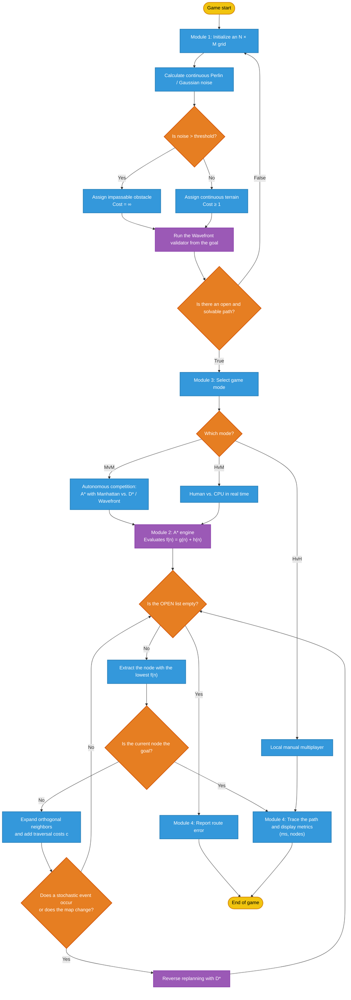

# Random Occupancy Grid Autopilot
An autonomous maze-solving system featuring probabilistic occupancy grids, stochastic terrain generation, and real-time pathfinding using D* algorithm with probabilistic noise in ROS with Rviz and Gazebo for simulating the real world physics.

<p align="center">
    
</p>

## Adaptive Path Clearance and Wall Avoidance

The pathfinding engine validates the neighboring quadrants around each candidate cell through the `has_clearance` function. This validation checks whether an obstacle is present within the configured clearance distance, allowing the A* algorithm to redirect the route before it reaches a wall or another blocked object.

The navigation cost includes a preference for paths that preserve one free cell between the route and nearby obstacles. When a candidate cell satisfies `clearance=1`, it keeps the preferred safety margin. If no route with this separation is available, the algorithm falls back to `clearance=0`, allowing it to pass through a narrow opening while still rejecting cells that are actual obstacles.

A penalty is added to candidates without the preferred clearance. This penalty does not make narrow passages impossible; it only makes them less attractive than equivalent paths that maintain one cell of separation. As a result, the planner avoids walls whenever possible while preserving the ability to find a valid path through constrained areas.
<p align="center">
    
</p>
## Spatial Generation and Computational Cost Reduction

The `Map` class implements the representation and generation of the navigation environment through a stochastic occupancy grid. Instead of determining the state of each cell using a sequential random process, the system uses spatial hashing to calculate each cell's value independently based on its position and a seed.

This procedure generates values that appear random while remaining reproducible and consistent for the same position and seed. The primary advantage is that a cell's state can be obtained on demand without storing the entire map or iterating through all previous cells, reducing memory usage and computational overhead.
<p align="center">
    
</p>

The `get_cell_cost` function adds an important exception to the probabilistic model: positions belonging to `carved_corridors` always receive a cost of `1.0`, even if the hash would otherwise classify them as obstacles or high-cost terrain. This guarantees that the generated maze contains traversable routes for the navigation algorithms.

From a scientific perspective, the design separates two processes with different purposes: *spatial hashing* deterministically controls the distribution of obstacles, while the path-carving process guarantees connectivity and solvability. This combination provides both stochastic variability and reproducible experiments.
<p align="center">
    
</p>



To generate the pseudorandom maze dynamically, the `generate_map` method uses Python's `time` library to create a seed from `time.thread_time_ns()`. This value is assigned to `self.seed`, allowing each maze generation to use a different time-based seed while preserving deterministic spatial hashing and corridor generation for that specific maze.

## ROS Simulation as a Computational Graph

The simulation can be understood as one larger system composed of ROS nodes. In this abstraction, each node is a vertex that performs a focused task, and each topic is a directed, typed edge that carries messages from a publisher to one or more subscribers. Connecting nodes means matching the publisher's topic name and message type with the corresponding subscriber; it does not require a separate graph-matching algorithm.

The current map node, `stochastic_map_node`, generates a 50 × 50 occupancy grid at 0.5 m resolution. It runs A* on that grid and publishes the resulting map, 3D wall markers, and planned route. RViz subscribes to those outputs and renders them alongside the robot model. The static transform broadcaster also publishes the `map` to `odom` frame relationship used to align visualization data.

| Topic | Message type | Role in the simulation |
| --- | --- | --- |
| `/stochastic_map` | `nav_msgs/OccupancyGrid` | Two-dimensional occupancy grid; occupied cells are encoded as 100 and free cells as 0. |
| `/maze_walls_3d` | `visualization_msgs/Marker` | `CUBE_LIST` marker containing the 3D positions of occupied cells. |
| `/planned_path` | `nav_msgs/Path` | A* route represented as ordered `PoseStamped` waypoints in the `map` frame. |
| `/tf_static` | `tf2_msgs/TFMessage` | Carries the static transform relating the `map` and `odom` frames. |

The map, marker, and path publishers are latched. A subscriber that connects after the map node has published can therefore receive the most recently published message, which is useful when RViz starts or reconnects after generation. In `simulation/maze_sim.rviz`, the Map, Marker, and Path displays subscribe to the corresponding topics above.

## Launch, Package, and Build Process

The Docker image provides the ROS Noetic environment and its TurtleBot3 dependencies. During the image build, `dockerfile` installs the required ROS packages, clones the `turtlebot3_simulations` source into `/root/catkin_ws/src`, and runs `catkin_make` after sourcing `/opt/ros/noetic/setup.bash`. The workspace's `devel/setup.bash` is then sourced at runtime so ROS can resolve the compiled simulation packages.

Build and start the environment from the repository root with:

```bash
docker build -t stochastic-maze-autopilot:noetic .
./run_sim.sh
```

`run_sim.sh` builds the image if it is not already available, mounts the repository at `/workspace`, passes through the display environment for RViz, sources the ROS and Catkin environments, and invokes `roslaunch /workspace/simulation/simulation.launch`.

The launch file coordinates the robot description (generated with `xacro`), the TurtleBot3 fake node, `robot_state_publisher`, the stochastic map script, and RViz with the saved configuration. Its `model` argument defaults to `burger`, and `sim_dir` identifies the directory containing the simulation scripts and RViz configuration. The map script is started through a `launch-prefix` that executes `python3` on `stocasticMapROS.py`; the node then publishes its outputs independently over the ROS topics described above.

This repository currently does not define a project-specific Catkin package: there is no project `package.xml` or `CMakeLists.txt`. The launch entries use the installed `turtlebot3_fake` package as their `pkg` value, while the Python map node is invoked from the mounted source directory. The Catkin workspace built in the Docker image belongs to the TurtleBot3 simulation dependency, not to this repository. A dedicated package would be needed before this project could be referenced as its own ROS package in a launch file.

The current `simulation.launch` also contains an `autopilot_follower.py` launch entry, but that file is not present in the repository. The ROS graph and topic descriptions above therefore cover the code that exists here; the follower cannot be considered an implemented or verified node until its script is added or the launch entry is removed.

## Graph Algorithms Used in the Project

The graph methods in the implementation serve two separate purposes: connecting sampled maze landmarks into traversable corridors, and finding a route through the resulting occupancy grid. The ROS computation graph is the communication architecture for running these components; it is not itself an additional pathfinding algorithm.

| Algorithm or method | Where it is used | Purpose and implementation status |
| --- | --- | --- |
| Kruskal's algorithm | `src/mazeMapping.py`, `Map.kruskal` | Builds a minimum spanning tree over sampled landmarks using Manhattan-weighted candidate edges. An edge is carved only when it joins different components. |
| Union-Find (disjoint-set) | `src/mazeMapping.py`, inside `Map.kruskal` | Tracks which landmarks are already connected while Kruskal processes edges. `find` uses path compression; accepted edges merge components. The accepted landmark edges are converted to horizontal and vertical carved corridors. |
| A* search | `src/pathfinding_engine.py`, `a_star`; invoked by `simulation/stocasticMapROS.py` | Finds a route from `(0, 0)` to `(49, 49)` on the generated grid. It uses four-directional neighbors, Manhattan distance as its heuristic, terrain traversal cost as `g`, and a 0.5 penalty when a neighbor lacks the preferred one-cell clearance. |
| Spatial hashing | `src/mazeMapping.py`, `space_hashing` | Assigns obstacle or free-cell costs from coordinates and a seed. This produces the stochastic occupancy grid; it is a deterministic spatial sampling method for a given seed, not a graph-search algorithm. |

D* is mentioned in the project overview and the earlier conceptual flow diagram, but there is no D* implementation or invocation in the current source files: the ROS map node calls A*. Likewise, the repository does not currently implement Wavefront search or an algorithmic graph-matching method. These are distinct from ROS topic connections, which associate publishers and subscribers by topic name and message type.