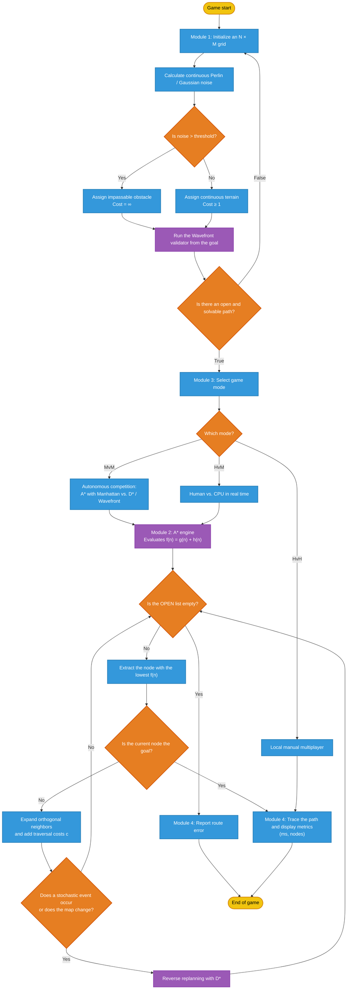

# Random Occupancy Grid Autopilot
An autonomous maze-solving system featuring probabilistic occupancy grids, stochastic terrain generation, and real-time pathfinding using D* algorithm with probabilistic noise in ROS with Rviz and Gazebo for simulating the real world physics.

    

## Adaptive Path Clearance and Wall Avoidance

The pathfinding engine validates the neighboring quadrants around each candidate cell through the `has_clearance` function. This validation checks whether an obstacle is present within the configured clearance distance, allowing the A* algorithm to redirect the route before it reaches a wall or another blocked object.

The navigation cost includes a preference for paths that preserve one free cell between the route and nearby obstacles. When a candidate cell satisfies `clearance=1`, it keeps the preferred safety margin. If no route with this separation is available, the algorithm falls back to `clearance=0`, allowing it to pass through a narrow opening while still rejecting cells that are actual obstacles.

A penalty is added to candidates without the preferred clearance. This penalty does not make narrow passages impossible; it only makes them less attractive than equivalent paths that maintain one cell of separation. As a result, the planner avoids walls whenever possible while preserving the ability to find a valid path through constrained areas.

## Spatial Generation and Computational Cost Reduction

The `Map` class implements the representation and generation of the navigation environment through a stochastic occupancy grid. Instead of determining the state of each cell using a sequential random process, the system uses spatial hashing to calculate each cell's value independently based on its position and a seed.

This procedure generates values that appear random while remaining reproducible and consistent for the same position and seed. The primary advantage is that a cell's state can be obtained on demand without storing the entire map or iterating through all previous cells, reducing memory usage and computational overhead.

    

The `get_cell_cost` function adds an important exception to the probabilistic model: positions belonging to `carved_corridors` always receive a cost of `1.0`, even if the hash would otherwise classify them as obstacles or high-cost terrain. This guarantees that the generated maze contains traversable routes for the navigation algorithms.

From a scientific perspective, the design separates two processes with different purposes: *spatial hashing* deterministically controls the distribution of obstacles, while the path-carving process guarantees connectivity and solvability. This combination provides both stochastic variability and reproducible experiments.

    

To generate the pseudorandom maze dynamically, the `generate_map` method uses Python's `time` library to create a seed from `time.thread_time_ns()`. This value is assigned to `self.seed`, allowing each maze generation to use a different time-based seed while preserving deterministic spatial hashing and corridor generation for that specific maze.
